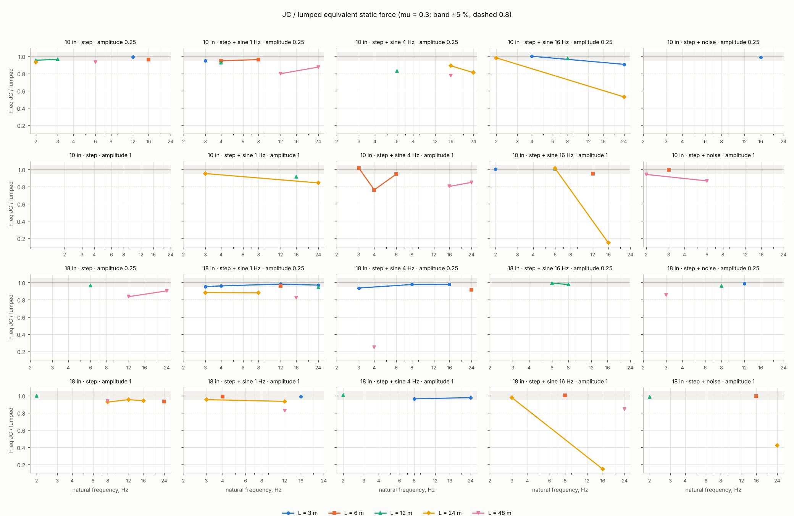
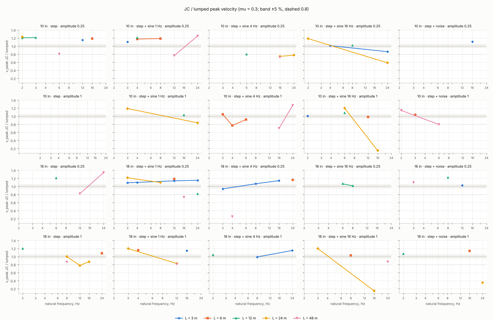
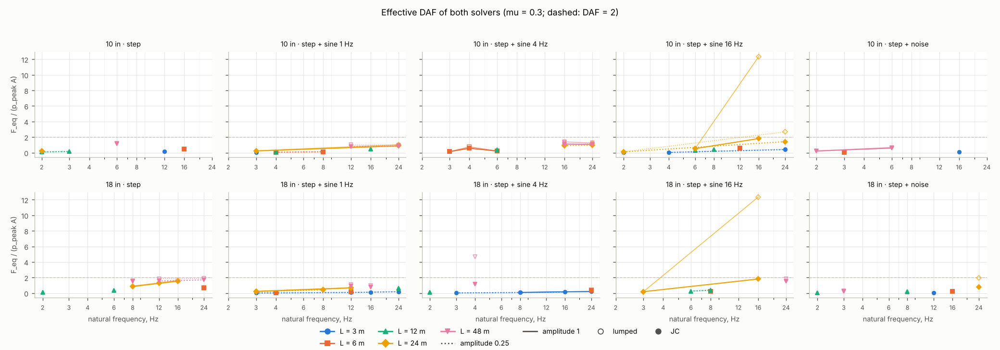
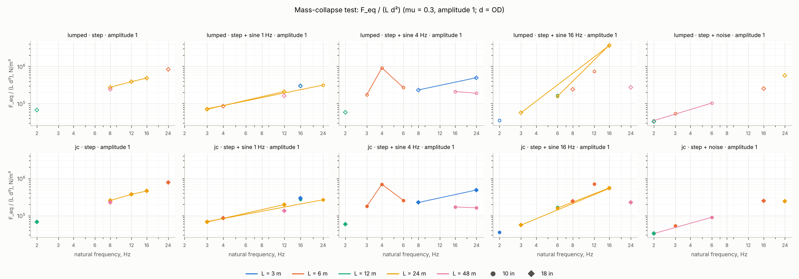

# Junction-coupling sweep (Session 5b)

Source: `sweep/tier1_subset10_ef89cbf.csv` — tier 1 (subset10), 160 rows (0 with errors), sizes 10 in, 18 in, git `ef89cbf`, CPU Intel(R) Xeon(R) Processor @ 2.30GHz. Generated by `tools/sweep_jc.py plot`; the column definitions are in `docs/data_format.md` ("sweep CSV (Session 5b)"). Both solvers run with the fixed-path defaults (F-1, F-2, F-4), `restrainFreqRatio = 1`, `gap = 0`, `stepQTY = 40`, celerity 1237 m/s, damping 0.5 %, E = 195 GPa; the pressure histories are `surge_sdof.histories.canonical` at 1000 Hz, peak `amplitude_fraction × 1.33 × p_design`. Frequency axes are the absolute natural frequency (the lumped `natFreq`, modelled with the contained fluid). Where several noise seeds exist, a plotted point is the pointwise max over seeds (the envelope); the per-seed rows stay in the CSV.

Run time per solver (this CSV): lumped mean 0.039 s (max 0.257 s), JC mean 0.149 s (max 0.616 s), 160 cases.

## 1. JC / lumped ratio of the equivalent static force and of the peak velocity

One line per span length, one panel per (size, history type, amplitude), friction on (mu = 0.3). The grey band is ±5 % of 1; the dashed line is 0.8.

## 2. Effective DAF F_eq / (p_peak A), lumped and JC

One panel per (size, history type), colour = length, line style = amplitude, hollow markers lumped and filled JC, mu = 0.3. The dashed line is DAF = 2.

## 3. Mass-collapse test: F_eq / (L d²)

All sizes and lengths on one panel per history type (top row lumped, bottom row JC), amplitude 1, mu = 0.3, d = OD. The spread table below states numerically what the panels show: a ratio near 1 means the curves of the different sizes and lengths fall on one line.

**Collapse spread** — max / min of F_eq / (L d²) over sizes and lengths at one natural frequency, mu = 0.3, amplitude 1 (median over frequencies [max])

| history | lumped | JC |
|---|---|---|
| step | 1.14 [1.14] | 1.13 [1.13] |
| step + sine 1 Hz | 1.03 [1.31] | 1.08 [1.48] |
| step + sine 4 Hz | 2.62 [2.62] | 3.02 [3.02] |
| step + sine 16 Hz | 1.04 [1.05] | 1.04 [1.04] |
| step + noise | 1.05 [1.05] | 1.00 [1.00] |

## 4. Where JC is negligible and where it is essential

Counts of cases per frequency band and span length (sizes and amplitudes pooled; noise seeds counted separately).

**step** — `ratio_f_eq`, mu = 0.3; cell = negligible (|r − 1| ≤ 5 %) / essential (r < 0.8) / other, of n cases; min r

| band | L = 3 m | L = 6 m | L = 12 m | L = 24 m | L = 48 m |
|---|---|---|---|---|---|
| ≤ 4 Hz | – | – | 3 / 0 / 0 of 3; min 0.96 | 0 / 0 / 1 of 1; min 0.93 | – |
| 4 – 8 Hz | – | – | 1 / 0 / 0 of 1; min 0.97 | 0 / 0 / 1 of 1; min 0.93 | 0 / 0 / 2 of 2; min 0.93 |
| 8 – 16 Hz | 1 / 0 / 0 of 1; min 0.99 | 1 / 0 / 0 of 1; min 0.96 | – | 1 / 0 / 1 of 2; min 0.94 | 0 / 0 / 1 of 1; min 0.84 |
| > 16 Hz | – | 0 / 0 / 1 of 1; min 0.93 | – | – | 0 / 0 / 1 of 1; min 0.90 |

**step + sine 1 Hz** — `ratio_f_eq`, mu = 0.3; cell = negligible (|r − 1| ≤ 5 %) / essential (r < 0.8) / other, of n cases; min r

| band | L = 3 m | L = 6 m | L = 12 m | L = 24 m | L = 48 m |
|---|---|---|---|---|---|
| ≤ 4 Hz | 2 / 0 / 1 of 3; min 0.95 | 1 / 0 / 1 of 2; min 0.95 | 0 / 0 / 1 of 1; min 0.93 | 2 / 0 / 1 of 3; min 0.88 | – |
| 4 – 8 Hz | – | 1 / 0 / 0 of 1; min 0.96 | – | 0 / 0 / 1 of 1; min 0.88 | – |
| 8 – 16 Hz | 2 / 0 / 0 of 2; min 0.98 | 1 / 0 / 0 of 1; min 0.96 | 0 / 0 / 1 of 1; min 0.92 | 0 / 0 / 1 of 1; min 0.93 | 0 / 1 / 2 of 3; min 0.80 |
| > 16 Hz | 1 / 0 / 0 of 1; min 0.97 | – | 0 / 0 / 1 of 1; min 0.94 | 0 / 0 / 1 of 1; min 0.84 | 0 / 0 / 1 of 1; min 0.87 |

**step + sine 4 Hz** — `ratio_f_eq`, mu = 0.3; cell = negligible (|r − 1| ≤ 5 %) / essential (r < 0.8) / other, of n cases; min r

| band | L = 3 m | L = 6 m | L = 12 m | L = 24 m | L = 48 m |
|---|---|---|---|---|---|
| ≤ 4 Hz | 0 / 0 / 1 of 1; min 0.94 | 1 / 1 / 0 of 2; min 0.76 | 1 / 0 / 0 of 1; min 1.01 | – | 0 / 1 / 0 of 1; min 0.25 |
| 4 – 8 Hz | 2 / 0 / 0 of 2; min 0.96 | 0 / 0 / 1 of 1; min 0.95 | 0 / 0 / 1 of 1; min 0.83 | – | – |
| 8 – 16 Hz | 1 / 0 / 0 of 1; min 0.98 | – | – | 0 / 0 / 1 of 1; min 0.89 | 0 / 1 / 1 of 2; min 0.78 |
| > 16 Hz | 1 / 0 / 0 of 1; min 0.98 | 0 / 0 / 1 of 1; min 0.92 | – | 0 / 0 / 1 of 1; min 0.81 | 0 / 0 / 1 of 1; min 0.85 |

**step + sine 16 Hz** — `ratio_f_eq`, mu = 0.3; cell = negligible (|r − 1| ≤ 5 %) / essential (r < 0.8) / other, of n cases; min r

| band | L = 3 m | L = 6 m | L = 12 m | L = 24 m | L = 48 m |
|---|---|---|---|---|---|
| ≤ 4 Hz | 2 / 0 / 0 of 2; min 1.00 | – | – | 2 / 0 / 0 of 2; min 0.98 | – |
| 4 – 8 Hz | – | 1 / 0 / 0 of 1; min 1.00 | 4 / 0 / 0 of 4; min 0.98 | 1 / 0 / 0 of 1; min 1.01 | – |
| 8 – 16 Hz | – | 1 / 0 / 0 of 1; min 0.95 | – | 0 / 2 / 0 of 2; min 0.15 | – |
| > 16 Hz | 0 / 0 / 1 of 1; min 0.91 | – | – | 0 / 1 / 0 of 1; min 0.53 | 0 / 0 / 1 of 1; min 0.84 |

**step + noise** — `ratio_f_eq`, mu = 0.3; cell = negligible (|r − 1| ≤ 5 %) / essential (r < 0.8) / other, of n cases; min r

| band | L = 3 m | L = 6 m | L = 12 m | L = 24 m | L = 48 m |
|---|---|---|---|---|---|
| ≤ 4 Hz | – | 1 / 0 / 0 of 1; min 0.99 | 1 / 0 / 0 of 1; min 0.99 | – | 0 / 0 / 2 of 2; min 0.86 |
| 4 – 8 Hz | – | – | 1 / 0 / 0 of 1; min 0.96 | – | 0 / 0 / 1 of 1; min 0.87 |
| 8 – 16 Hz | 2 / 0 / 0 of 2; min 0.99 | 1 / 0 / 0 of 1; min 0.99 | – | – | – |
| > 16 Hz | – | – | – | 0 / 1 / 0 of 1; min 0.42 | – |

**step** — `ratio_v_peak`, mu = 0.3; cell = negligible (|r − 1| ≤ 5 %) / essential (r < 0.8) / other, of n cases; min r

| band | L = 3 m | L = 6 m | L = 12 m | L = 24 m | L = 48 m |
|---|---|---|---|---|---|
| ≤ 4 Hz | – | – | 0 / 0 / 3 of 3; min 1.20 | 0 / 0 / 1 of 1; min 1.23 | – |
| 4 – 8 Hz | – | – | 0 / 0 / 1 of 1; min 1.21 | 1 / 0 / 0 of 1; min 1.00 | 0 / 0 / 2 of 2; min 0.81 |
| 8 – 16 Hz | 0 / 0 / 1 of 1; min 1.15 | 0 / 0 / 1 of 1; min 1.19 | – | 0 / 1 / 1 of 2; min 0.78 | 0 / 0 / 1 of 1; min 0.82 |
| > 16 Hz | – | 0 / 0 / 1 of 1; min 1.08 | – | – | 0 / 0 / 1 of 1; min 1.34 |

**step + sine 1 Hz** — `ratio_v_peak`, mu = 0.3; cell = negligible (|r − 1| ≤ 5 %) / essential (r < 0.8) / other, of n cases; min r

| band | L = 3 m | L = 6 m | L = 12 m | L = 24 m | L = 48 m |
|---|---|---|---|---|---|
| ≤ 4 Hz | 0 / 0 / 3 of 3; min 1.09 | 0 / 0 / 2 of 2; min 1.16 | 0 / 0 / 1 of 1; min 1.21 | 0 / 0 / 3 of 3; min 1.19 | – |
| 4 – 8 Hz | – | 0 / 0 / 1 of 1; min 1.19 | – | 0 / 0 / 1 of 1; min 1.10 | – |
| 8 – 16 Hz | 0 / 0 / 2 of 2; min 1.14 | 0 / 0 / 1 of 1; min 1.18 | 1 / 0 / 0 of 1; min 1.03 | 0 / 0 / 1 of 1; min 0.83 | 0 / 2 / 1 of 3; min 0.73 |
| > 16 Hz | 0 / 0 / 1 of 1; min 1.15 | – | 0 / 0 / 1 of 1; min 0.82 | 0 / 0 / 1 of 1; min 0.84 | 0 / 0 / 1 of 1; min 1.25 |

**step + sine 4 Hz** — `ratio_v_peak`, mu = 0.3; cell = negligible (|r − 1| ≤ 5 %) / essential (r < 0.8) / other, of n cases; min r

| band | L = 3 m | L = 6 m | L = 12 m | L = 24 m | L = 48 m |
|---|---|---|---|---|---|
| ≤ 4 Hz | 0 / 0 / 1 of 1; min 0.94 | 1 / 1 / 0 of 2; min 0.77 | 1 / 0 / 0 of 1; min 1.04 | – | 0 / 1 / 0 of 1; min 0.25 |
| 4 – 8 Hz | 1 / 0 / 1 of 2; min 0.99 | 0 / 0 / 1 of 1; min 0.92 | 0 / 0 / 1 of 1; min 0.80 | – | – |
| 8 – 16 Hz | 0 / 0 / 1 of 1; min 1.14 | – | – | 0 / 1 / 0 of 1; min 0.75 | 0 / 2 / 0 of 2; min 0.70 |
| > 16 Hz | 0 / 0 / 1 of 1; min 1.15 | 0 / 0 / 1 of 1; min 1.16 | – | 0 / 1 / 0 of 1; min 0.77 | 0 / 0 / 1 of 1; min 1.27 |

**step + sine 16 Hz** — `ratio_v_peak`, mu = 0.3; cell = negligible (|r − 1| ≤ 5 %) / essential (r < 0.8) / other, of n cases; min r

| band | L = 3 m | L = 6 m | L = 12 m | L = 24 m | L = 48 m |
|---|---|---|---|---|---|
| ≤ 4 Hz | 2 / 0 / 0 of 2; min 1.00 | – | – | 0 / 0 / 2 of 2; min 1.19 | – |
| 4 – 8 Hz | – | 1 / 0 / 0 of 1; min 1.03 | 2 / 0 / 2 of 4; min 1.01 | 0 / 0 / 1 of 1; min 1.20 | – |
| 8 – 16 Hz | – | 1 / 0 / 0 of 1; min 0.98 | – | 0 / 2 / 0 of 2; min 0.15 | – |
| > 16 Hz | 0 / 0 / 1 of 1; min 0.86 | – | – | 0 / 1 / 0 of 1; min 0.59 | 0 / 0 / 1 of 1; min 0.87 |

**step + noise** — `ratio_v_peak`, mu = 0.3; cell = negligible (|r − 1| ≤ 5 %) / essential (r < 0.8) / other, of n cases; min r

| band | L = 3 m | L = 6 m | L = 12 m | L = 24 m | L = 48 m |
|---|---|---|---|---|---|
| ≤ 4 Hz | – | 1 / 0 / 0 of 1; min 1.04 | 0 / 0 / 1 of 1; min 1.07 | – | 0 / 0 / 2 of 2; min 1.10 |
| 4 – 8 Hz | – | – | 0 / 0 / 1 of 1; min 1.22 | – | 0 / 1 / 0 of 1; min 0.79 |
| 8 – 16 Hz | 1 / 0 / 1 of 2; min 1.02 | 0 / 0 / 1 of 1; min 1.14 | – | – | – |
| > 16 Hz | – | – | – | 0 / 1 / 0 of 1; min 0.36 | – |

**Amplitude dependence** — DAF(amplitude 0.25) / DAF(amplitude 1), mu = 0.3, median [min – max] over sizes and lengths (n pairs)

| history | solver | ≤ 4 Hz | 4 – 8 Hz | 8 – 16 Hz | > 16 Hz |
|---|---|---|---|---|---|
| step | lumped | – | – | – | – |
| step | jc | – | – | – | – |
| step + sine 1 Hz | lumped | 0.85 [0.85 – 0.85] (1) | – | – | – |
| step + sine 1 Hz | jc | 0.78 [0.78 – 0.78] (1) | – | – | – |
| step + sine 4 Hz | lumped | – | 0.80 [0.80 – 0.80] (1) | 0.95 [0.95 – 0.95] (1) | – |
| step + sine 4 Hz | jc | – | 0.81 [0.81 – 0.81] (1) | 0.92 [0.92 – 0.92] (1) | – |
| step + sine 16 Hz | lumped | – | – | – | – |
| step + sine 16 Hz | jc | – | – | – | – |
| step + noise | lumped | – | – | – | – |
| step + noise | jc | – | – | – | – |

