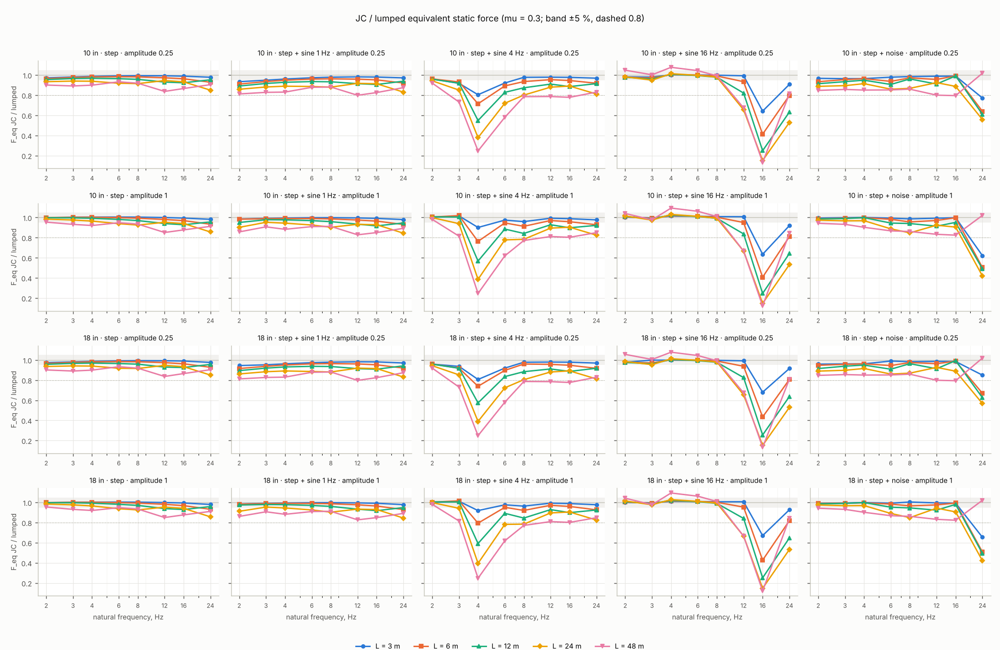
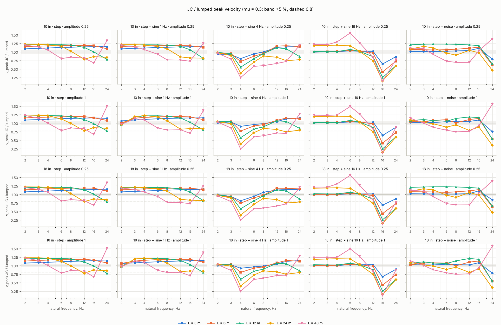
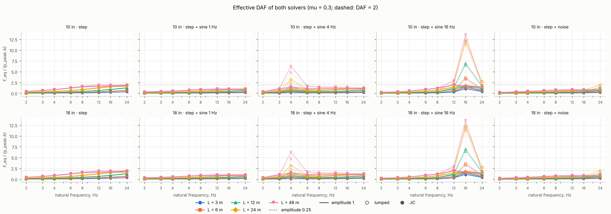
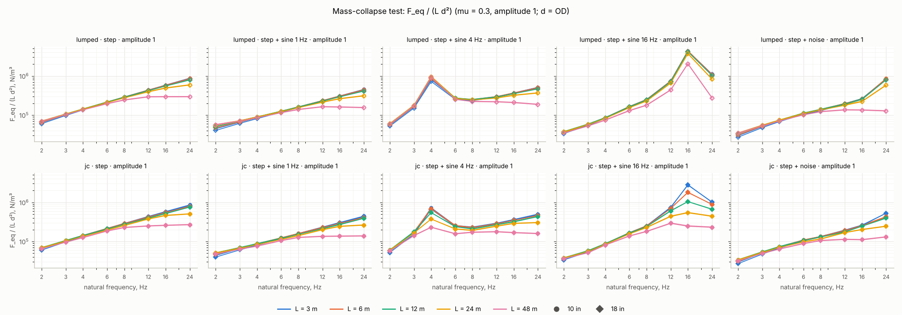

# Junction-coupling sweep (Session 5b)

Source: `sweep/tier1_8590c3f.csv` — tier 1, 1600 rows (0 with errors), sizes 10 in, 18 in, git `8590c3f`, CPU Intel(R) Xeon(R) Processor @ 2.30GHz. Generated by `tools/sweep_jc.py plot`; the column definitions are in `docs/data_format.md` ("sweep CSV (Session 5b)"). Both solvers run with the fixed-path defaults (F-1, F-2, F-4), `restrainFreqRatio = 1`, `gap = 0`, `stepQTY = 40`, celerity 1237 m/s, damping 0.5 %, E = 195 GPa; the pressure histories are `surge_sdof.histories.canonical` at 1000 Hz, peak `amplitude_fraction × 1.33 × p_design`. Frequency axes are the absolute natural frequency (the lumped `natFreq`, modelled with the contained fluid). Where several noise seeds exist, a plotted point is the pointwise max over seeds (the envelope); the per-seed rows stay in the CSV.

Run time per solver (this CSV): lumped mean 0.036 s (max 0.194 s), JC mean 0.152 s (max 0.688 s), 1600 cases.

## 1. JC / lumped ratio of the equivalent static force and of the peak velocity

One line per span length, one panel per (size, history type, amplitude), friction on (mu = 0.3). The grey band is ±5 % of 1; the dashed line is 0.8.

## 2. Effective DAF F_eq / (p_peak A), lumped and JC

One panel per (size, history type), colour = length, line style = amplitude, hollow markers lumped and filled JC, mu = 0.3. The dashed line is DAF = 2.

## 3. Mass-collapse test: F_eq / (L d²)

All sizes and lengths on one panel per history type (top row lumped, bottom row JC), amplitude 1, mu = 0.3, d = OD. The spread table below states numerically what the panels show: a ratio near 1 means the curves of the different sizes and lengths fall on one line.

**Collapse spread** — max / min of F_eq / (L d²) over sizes and lengths at one natural frequency, mu = 0.3, amplitude 1 (median over frequencies [max])

| history | lumped | JC |
|---|---|---|
| step | 1.19 [3.00] | 1.23 [3.24] |
| step + sine 1 Hz | 1.30 [2.95] | 1.29 [3.25] |
| step + sine 4 Hz | 1.27 [2.76] | 1.67 [3.18] |
| step + sine 16 Hz | 1.36 [4.09] | 1.32 [11.52] |
| step + noise | 1.23 [6.79] | 1.28 [4.10] |

## 4. Where JC is negligible and where it is essential

Counts of cases per frequency band and span length (sizes and amplitudes pooled; noise seeds counted separately).

**step** — `ratio_f_eq`, mu = 0.3; cell = negligible (|r − 1| ≤ 5 %) / essential (r < 0.8) / other, of n cases; min r

| band | L = 3 m | L = 6 m | L = 12 m | L = 24 m | L = 48 m |
|---|---|---|---|---|---|
| ≤ 4 Hz | 12 / 0 / 0 of 12; min 0.97 | 12 / 0 / 0 of 12; min 0.96 | 12 / 0 / 0 of 12; min 0.96 | 6 / 0 / 6 of 12; min 0.93 | 2 / 0 / 10 of 12; min 0.89 |
| 4 – 8 Hz | 8 / 0 / 0 of 8; min 0.99 | 8 / 0 / 0 of 8; min 0.98 | 8 / 0 / 0 of 8; min 0.96 | 0 / 0 / 8 of 8; min 0.91 | 0 / 0 / 8 of 8; min 0.92 |
| 8 – 16 Hz | 8 / 0 / 0 of 8; min 0.99 | 8 / 0 / 0 of 8; min 0.96 | 0 / 0 / 8 of 8; min 0.92 | 2 / 0 / 6 of 8; min 0.93 | 0 / 0 / 8 of 8; min 0.84 |
| > 16 Hz | 4 / 0 / 0 of 4; min 0.98 | 0 / 0 / 4 of 4; min 0.93 | 4 / 0 / 0 of 4; min 0.95 | 0 / 0 / 4 of 4; min 0.85 | 0 / 0 / 4 of 4; min 0.90 |

**step + sine 1 Hz** — `ratio_f_eq`, mu = 0.3; cell = negligible (|r − 1| ≤ 5 %) / essential (r < 0.8) / other, of n cases; min r

| band | L = 3 m | L = 6 m | L = 12 m | L = 24 m | L = 48 m |
|---|---|---|---|---|---|
| ≤ 4 Hz | 9 / 0 / 3 of 12; min 0.93 | 7 / 0 / 5 of 12; min 0.91 | 6 / 0 / 6 of 12; min 0.89 | 2 / 0 / 10 of 12; min 0.86 | 0 / 0 / 12 of 12; min 0.81 |
| 4 – 8 Hz | 8 / 0 / 0 of 8; min 0.97 | 8 / 0 / 0 of 8; min 0.96 | 4 / 0 / 4 of 8; min 0.93 | 0 / 0 / 8 of 8; min 0.88 | 0 / 0 / 8 of 8; min 0.88 |
| 8 – 16 Hz | 8 / 0 / 0 of 8; min 0.98 | 8 / 0 / 0 of 8; min 0.95 | 0 / 0 / 8 of 8; min 0.91 | 0 / 0 / 8 of 8; min 0.91 | 0 / 2 / 6 of 8; min 0.80 |
| > 16 Hz | 4 / 0 / 0 of 4; min 0.97 | 0 / 0 / 4 of 4; min 0.92 | 0 / 0 / 4 of 4; min 0.94 | 0 / 0 / 4 of 4; min 0.83 | 0 / 0 / 4 of 4; min 0.87 |

**step + sine 4 Hz** — `ratio_f_eq`, mu = 0.3; cell = negligible (|r − 1| ≤ 5 %) / essential (r < 0.8) / other, of n cases; min r

| band | L = 3 m | L = 6 m | L = 12 m | L = 24 m | L = 48 m |
|---|---|---|---|---|---|
| ≤ 4 Hz | 6 / 0 / 6 of 12; min 0.80 | 6 / 4 / 2 of 12; min 0.71 | 6 / 4 / 2 of 12; min 0.55 | 2 / 4 / 6 of 12; min 0.38 | 2 / 6 / 4 of 12; min 0.25 |
| 4 – 8 Hz | 6 / 0 / 2 of 8; min 0.92 | 2 / 0 / 6 of 8; min 0.89 | 0 / 0 / 8 of 8; min 0.83 | 0 / 6 / 2 of 8; min 0.72 | 0 / 8 / 0 of 8; min 0.58 |
| 8 – 16 Hz | 8 / 0 / 0 of 8; min 0.98 | 6 / 0 / 2 of 8; min 0.95 | 0 / 0 / 8 of 8; min 0.89 | 0 / 0 / 8 of 8; min 0.88 | 0 / 4 / 4 of 8; min 0.78 |
| > 16 Hz | 4 / 0 / 0 of 4; min 0.97 | 0 / 0 / 4 of 4; min 0.92 | 0 / 0 / 4 of 4; min 0.91 | 0 / 0 / 4 of 4; min 0.81 | 0 / 0 / 4 of 4; min 0.83 |

**step + sine 16 Hz** — `ratio_f_eq`, mu = 0.3; cell = negligible (|r − 1| ≤ 5 %) / essential (r < 0.8) / other, of n cases; min r

| band | L = 3 m | L = 6 m | L = 12 m | L = 24 m | L = 48 m |
|---|---|---|---|---|---|
| ≤ 4 Hz | 12 / 0 / 0 of 12; min 0.98 | 12 / 0 / 0 of 12; min 0.97 | 12 / 0 / 0 of 12; min 0.96 | 11 / 0 / 1 of 12; min 0.95 | 7 / 0 / 5 of 12; min 0.98 |
| 4 – 8 Hz | 8 / 0 / 0 of 8; min 1.00 | 8 / 0 / 0 of 8; min 0.99 | 8 / 0 / 0 of 8; min 0.98 | 8 / 0 / 0 of 8; min 0.98 | 6 / 0 / 2 of 8; min 0.99 |
| 8 – 16 Hz | 4 / 4 / 0 of 8; min 0.63 | 2 / 4 / 2 of 8; min 0.41 | 0 / 4 / 4 of 8; min 0.25 | 0 / 8 / 0 of 8; min 0.15 | 0 / 8 / 0 of 8; min 0.12 |
| > 16 Hz | 0 / 0 / 4 of 4; min 0.91 | 0 / 1 / 3 of 4; min 0.80 | 0 / 4 / 0 of 4; min 0.63 | 0 / 4 / 0 of 4; min 0.53 | 0 / 0 / 4 of 4; min 0.81 |

**step + noise** — `ratio_f_eq`, mu = 0.3; cell = negligible (|r − 1| ≤ 5 %) / essential (r < 0.8) / other, of n cases; min r

| band | L = 3 m | L = 6 m | L = 12 m | L = 24 m | L = 48 m |
|---|---|---|---|---|---|
| ≤ 4 Hz | 12 / 0 / 0 of 12; min 0.96 | 10 / 0 / 2 of 12; min 0.93 | 6 / 0 / 6 of 12; min 0.91 | 6 / 0 / 6 of 12; min 0.89 | 0 / 0 / 12 of 12; min 0.85 |
| 4 – 8 Hz | 8 / 0 / 0 of 8; min 0.98 | 6 / 0 / 2 of 8; min 0.94 | 3 / 0 / 5 of 8; min 0.91 | 0 / 0 / 8 of 8; min 0.85 | 0 / 0 / 8 of 8; min 0.85 |
| 8 – 16 Hz | 8 / 0 / 0 of 8; min 0.98 | 8 / 0 / 0 of 8; min 0.96 | 4 / 0 / 4 of 8; min 0.91 | 0 / 0 / 8 of 8; min 0.89 | 0 / 3 / 5 of 8; min 0.79 |
| > 16 Hz | 0 / 3 / 1 of 4; min 0.62 | 0 / 4 / 0 of 4; min 0.50 | 0 / 4 / 0 of 4; min 0.49 | 0 / 4 / 0 of 4; min 0.42 | 4 / 0 / 0 of 4; min 1.02 |

**step** — `ratio_v_peak`, mu = 0.3; cell = negligible (|r − 1| ≤ 5 %) / essential (r < 0.8) / other, of n cases; min r

| band | L = 3 m | L = 6 m | L = 12 m | L = 24 m | L = 48 m |
|---|---|---|---|---|---|
| ≤ 4 Hz | 0 / 0 / 12 of 12; min 1.08 | 0 / 0 / 12 of 12; min 1.14 | 0 / 0 / 12 of 12; min 1.20 | 0 / 0 / 12 of 12; min 1.21 | 2 / 0 / 10 of 12; min 1.00 |
| 4 – 8 Hz | 0 / 0 / 8 of 8; min 1.11 | 0 / 0 / 8 of 8; min 1.18 | 0 / 0 / 8 of 8; min 1.20 | 4 / 0 / 4 of 8; min 0.99 | 0 / 2 / 6 of 8; min 0.78 |
| 8 – 16 Hz | 0 / 0 / 8 of 8; min 1.14 | 0 / 0 / 8 of 8; min 1.16 | 4 / 0 / 4 of 8; min 0.99 | 0 / 4 / 4 of 8; min 0.78 | 0 / 4 / 4 of 8; min 0.67 |
| > 16 Hz | 0 / 0 / 4 of 4; min 1.14 | 0 / 0 / 4 of 4; min 1.08 | 0 / 4 / 0 of 4; min 0.77 | 0 / 0 / 4 of 4; min 0.84 | 0 / 0 / 4 of 4; min 1.33 |

**step + sine 1 Hz** — `ratio_v_peak`, mu = 0.3; cell = negligible (|r − 1| ≤ 5 %) / essential (r < 0.8) / other, of n cases; min r

| band | L = 3 m | L = 6 m | L = 12 m | L = 24 m | L = 48 m |
|---|---|---|---|---|---|
| ≤ 4 Hz | 0 / 0 / 12 of 12; min 1.07 | 1 / 0 / 11 of 12; min 1.00 | 2 / 0 / 10 of 12; min 0.96 | 2 / 0 / 10 of 12; min 0.96 | 2 / 0 / 10 of 12; min 0.97 |
| 4 – 8 Hz | 0 / 0 / 8 of 8; min 1.11 | 0 / 0 / 8 of 8; min 1.18 | 0 / 0 / 8 of 8; min 1.20 | 0 / 0 / 8 of 8; min 1.07 | 0 / 2 / 6 of 8; min 0.77 |
| 8 – 16 Hz | 0 / 0 / 8 of 8; min 1.14 | 0 / 0 / 8 of 8; min 1.18 | 2 / 0 / 6 of 8; min 1.03 | 0 / 0 / 8 of 8; min 0.83 | 0 / 6 / 2 of 8; min 0.70 |
| > 16 Hz | 0 / 0 / 4 of 4; min 1.15 | 0 / 0 / 4 of 4; min 1.10 | 0 / 1 / 3 of 4; min 0.80 | 0 / 0 / 4 of 4; min 0.82 | 0 / 0 / 4 of 4; min 1.25 |

**step + sine 4 Hz** — `ratio_v_peak`, mu = 0.3; cell = negligible (|r − 1| ≤ 5 %) / essential (r < 0.8) / other, of n cases; min r

| band | L = 3 m | L = 6 m | L = 12 m | L = 24 m | L = 48 m |
|---|---|---|---|---|---|
| ≤ 4 Hz | 5 / 0 / 7 of 12; min 0.80 | 6 / 3 / 3 of 12; min 0.72 | 7 / 4 / 1 of 12; min 0.55 | 6 / 4 / 2 of 12; min 0.38 | 4 / 6 / 2 of 12; min 0.25 |
| 4 – 8 Hz | 5 / 0 / 3 of 8; min 0.94 | 4 / 0 / 4 of 8; min 0.88 | 2 / 0 / 6 of 8; min 0.80 | 0 / 4 / 4 of 8; min 0.70 | 0 / 8 / 0 of 8; min 0.58 |
| 8 – 16 Hz | 2 / 0 / 6 of 8; min 1.04 | 0 / 0 / 8 of 8; min 1.08 | 0 / 0 / 8 of 8; min 1.05 | 0 / 4 / 4 of 8; min 0.75 | 0 / 8 / 0 of 8; min 0.66 |
| > 16 Hz | 0 / 0 / 4 of 4; min 1.15 | 0 / 0 / 4 of 4; min 1.13 | 0 / 0 / 4 of 4; min 0.85 | 0 / 4 / 0 of 4; min 0.77 | 0 / 0 / 4 of 4; min 1.20 |

**step + sine 16 Hz** — `ratio_v_peak`, mu = 0.3; cell = negligible (|r − 1| ≤ 5 %) / essential (r < 0.8) / other, of n cases; min r

| band | L = 3 m | L = 6 m | L = 12 m | L = 24 m | L = 48 m |
|---|---|---|---|---|---|
| ≤ 4 Hz | 12 / 0 / 0 of 12; min 0.99 | 12 / 0 / 0 of 12; min 0.99 | 12 / 0 / 0 of 12; min 1.01 | 0 / 0 / 12 of 12; min 1.18 | 0 / 0 / 12 of 12; min 1.21 |
| 4 – 8 Hz | 8 / 0 / 0 of 8; min 1.01 | 7 / 0 / 1 of 8; min 1.02 | 4 / 0 / 4 of 8; min 1.01 | 4 / 0 / 4 of 8; min 1.01 | 0 / 0 / 8 of 8; min 1.26 |
| 8 – 16 Hz | 4 / 4 / 0 of 8; min 0.64 | 4 / 4 / 0 of 8; min 0.41 | 0 / 4 / 4 of 8; min 0.25 | 0 / 8 / 0 of 8; min 0.15 | 0 / 4 / 4 of 8; min 0.13 |
| > 16 Hz | 0 / 0 / 4 of 4; min 0.86 | 0 / 4 / 0 of 4; min 0.73 | 0 / 4 / 0 of 4; min 0.60 | 0 / 4 / 0 of 4; min 0.59 | 0 / 2 / 2 of 4; min 0.77 |

**step + noise** — `ratio_v_peak`, mu = 0.3; cell = negligible (|r − 1| ≤ 5 %) / essential (r < 0.8) / other, of n cases; min r

| band | L = 3 m | L = 6 m | L = 12 m | L = 24 m | L = 48 m |
|---|---|---|---|---|---|
| ≤ 4 Hz | 12 / 0 / 0 of 12; min 1.01 | 2 / 0 / 10 of 12; min 1.03 | 0 / 0 / 12 of 12; min 1.07 | 4 / 0 / 8 of 12; min 0.98 | 2 / 0 / 10 of 12; min 0.88 |
| 4 – 8 Hz | 7 / 0 / 1 of 8; min 1.01 | 2 / 0 / 6 of 8; min 1.00 | 0 / 0 / 8 of 8; min 1.06 | 3 / 0 / 5 of 8; min 0.89 | 0 / 8 / 0 of 8; min 0.69 |
| 8 – 16 Hz | 3 / 0 / 5 of 8; min 1.02 | 0 / 0 / 8 of 8; min 1.10 | 0 / 0 / 8 of 8; min 1.16 | 3 / 1 / 4 of 8; min 0.79 | 2 / 4 / 2 of 8; min 0.70 |
| > 16 Hz | 0 / 3 / 1 of 4; min 0.76 | 0 / 4 / 0 of 4; min 0.53 | 0 / 4 / 0 of 4; min 0.54 | 0 / 4 / 0 of 4; min 0.35 | 0 / 0 / 4 of 4; min 1.38 |

**Amplitude dependence** — DAF(amplitude 0.25) / DAF(amplitude 1), mu = 0.3, median [min – max] over sizes and lengths (n pairs)

| history | solver | ≤ 4 Hz | 4 – 8 Hz | 8 – 16 Hz | > 16 Hz |
|---|---|---|---|---|---|
| step | lumped | 0.89 [0.61 – 0.94] (30) | 0.95 [0.89 – 0.97] (20) | 0.97 [0.96 – 0.98] (20) | 0.98 [0.96 – 0.99] (10) |
| step | jc | 0.85 [0.59 – 0.91] (30) | 0.94 [0.88 – 0.95] (20) | 0.96 [0.94 – 0.98] (20) | 0.98 [0.95 – 0.98] (10) |
| step + sine 1 Hz | lumped | 0.76 [0.38 – 0.89] (30) | 0.91 [0.80 – 0.94] (20) | 0.95 [0.91 – 0.96] (20) | 0.97 [0.92 – 0.97] (10) |
| step + sine 1 Hz | jc | 0.72 [0.36 – 0.84] (30) | 0.88 [0.78 – 0.91] (20) | 0.93 [0.89 – 0.95] (20) | 0.96 [0.90 – 0.96] (10) |
| step + sine 4 Hz | lumped | 0.75 [0.25 – 0.89] (30) | 0.88 [0.69 – 0.91] (20) | 0.95 [0.92 – 0.97] (20) | 0.97 [0.94 – 0.97] (10) |
| step + sine 4 Hz | jc | 0.73 [0.22 – 0.84] (30) | 0.84 [0.65 – 0.92] (20) | 0.94 [0.91 – 0.95] (20) | 0.96 [0.91 – 0.97] (10) |
| step + sine 16 Hz | lumped | 0.88 [0.69 – 0.95] (30) | 0.95 [0.91 – 0.97] (20) | 0.92 [0.85 – 0.96] (20) | 0.97 [0.96 – 0.98] (10) |
| step + sine 16 Hz | jc | 0.87 [0.67 – 0.94] (30) | 0.94 [0.90 – 0.95] (20) | 0.94 [0.86 – 0.95] (20) | 0.95 [0.94 – 0.97] (10) |
| step + noise | lumped | 0.80 [0.44 – 0.89] (30) | 0.87 [0.75 – 0.89] (20) | 0.93 [0.90 – 0.97] (20) | 0.75 [0.64 – 0.91] (10) |
| step + noise | jc | 0.73 [0.43 – 0.84] (30) | 0.85 [0.75 – 0.91] (20) | 0.93 [0.87 – 0.96] (20) | 0.94 [0.83 – 0.97] (10) |

