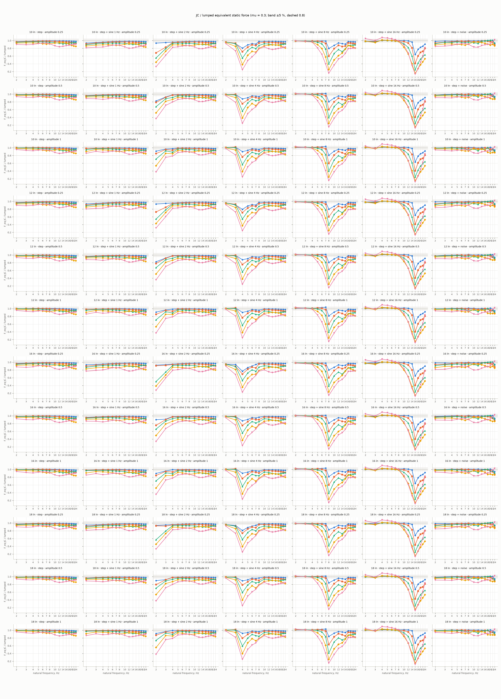
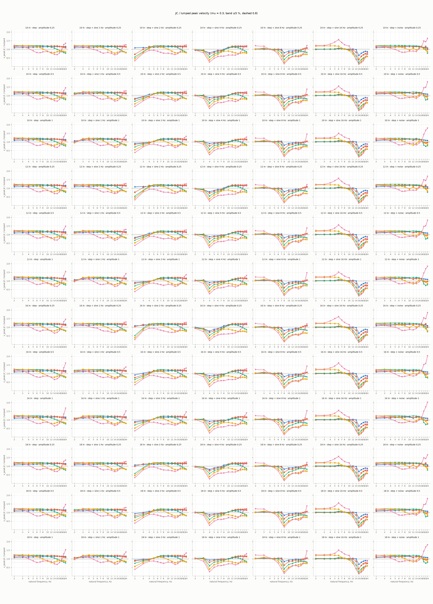
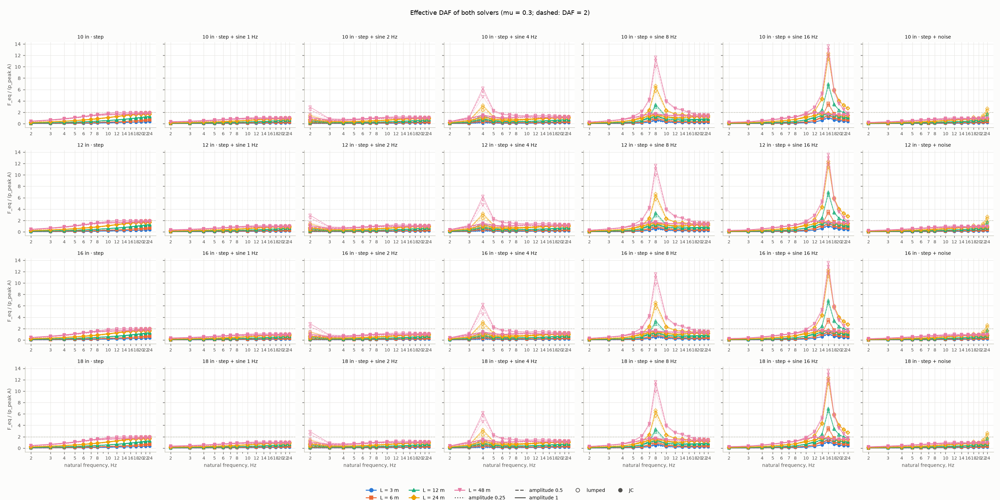
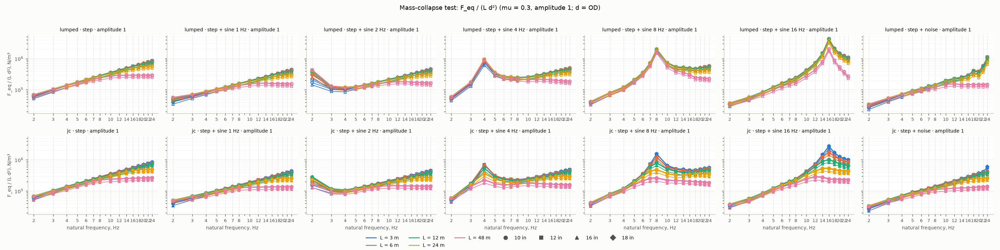

# Junction-coupling sweep (Session 5b)

Source: `sweep/tier2_3664dc7_f4b.csv` — tier 2, 24300 rows (0 with errors), sizes 10 in, 12 in, 16 in, 18 in, git `3664dc7`, CPU 13th Gen Intel(R) Core(TM) i5-13600KF. Generated by `tools/sweep_jc.py plot`; the column definitions are in `docs/data_format.md` ("sweep CSV (Session 5b)"). Both solvers run with the fixed-path defaults (F-1, F-2, F-4), `restrainFreqRatio = 1`, `gap = 0`, `stepQTY = 40`, celerity 1237 m/s, damping 0.5 %, E = 195 GPa; the pressure histories are `surge_sdof.histories.canonical` at 1000 Hz, peak `amplitude_fraction × 1.33 × p_design`. Frequency axes are the absolute natural frequency (the lumped `natFreq`, modelled with the contained fluid). Where several noise seeds exist, a plotted point is the pointwise max over seeds (the envelope); the per-seed rows stay in the CSV.

Run time per solver (this CSV): lumped mean 0.066 s (max 0.571 s), JC mean 0.258 s (max 2.201 s), 24300 cases.

## 1. JC / lumped ratio of the equivalent static force and of the peak velocity

One line per span length, one panel per (size, history type, amplitude), friction on (mu = 0.3). The grey band is ±5 % of 1; the dashed line is 0.8.

## 2. Effective DAF F_eq / (p_peak A), lumped and JC

One panel per (size, history type), colour = length, line style = amplitude, hollow markers lumped and filled JC, mu = 0.3. The dashed line is DAF = 2.

## 3. Mass-collapse test: F_eq / (L d²)

All sizes and lengths on one panel per history type (top row lumped, bottom row JC), amplitude 1, mu = 0.3, d = OD. The spread table below states numerically what the panels show: a ratio near 1 means the curves of the different sizes and lengths fall on one line.

**Collapse spread** — max / min of F_eq / (L d²) over sizes and lengths at one natural frequency, mu = 0.3, amplitude 1 (median over frequencies [max])

| history | lumped | JC |
|---|---|---|
| step | 1.55 [3.50] | 1.82 [3.83] |
| step + sine 1 Hz | 1.66 [3.45] | 1.79 [3.85] |
| step + sine 2 Hz | 1.65 [3.36] | 2.07 [3.83] |
| step + sine 4 Hz | 1.58 [3.22] | 2.25 [4.00] |
| step + sine 8 Hz | 1.47 [3.07] | 2.89 [7.66] |
| step + sine 16 Hz | 1.82 [4.77] | 2.20 [14.22] |
| step + noise | 1.79 [10.69] | 2.03 [5.41] |

## 4. Where JC is negligible and where it is essential

Counts of cases per frequency band and span length (sizes and amplitudes pooled; noise seeds counted separately).

**step** — `ratio_f_eq`, mu = 0.3; cell = negligible (|r − 1| ≤ 5 %) / essential (r < 0.8) / other, of n cases; min r

| band | L = 3 m | L = 6 m | L = 12 m | L = 24 m | L = 48 m |
|---|---|---|---|---|---|
| ≤ 4 Hz | 36 / 0 / 0 of 36; min 0.97 | 36 / 0 / 0 of 36; min 0.96 | 35 / 0 / 1 of 36; min 0.94 | 23 / 0 / 13 of 36; min 0.92 | 3 / 0 / 33 of 36; min 0.87 |
| 4 – 8 Hz | 48 / 0 / 0 of 48; min 0.99 | 48 / 0 / 0 of 48; min 0.98 | 48 / 0 / 0 of 48; min 0.95 | 3 / 0 / 45 of 48; min 0.89 | 0 / 0 / 48 of 48; min 0.90 |
| 8 – 16 Hz | 48 / 0 / 0 of 48; min 0.99 | 48 / 0 / 0 of 48; min 0.96 | 7 / 0 / 41 of 48; min 0.91 | 10 / 0 / 38 of 48; min 0.92 | 0 / 0 / 48 of 48; min 0.81 |
| > 16 Hz | 48 / 0 / 0 of 48; min 0.97 | 15 / 0 / 33 of 48; min 0.92 | 16 / 0 / 32 of 48; min 0.92 | 0 / 0 / 48 of 48; min 0.83 | 0 / 0 / 48 of 48; min 0.86 |

**step + sine 1 Hz** — `ratio_f_eq`, mu = 0.3; cell = negligible (|r − 1| ≤ 5 %) / essential (r < 0.8) / other, of n cases; min r

| band | L = 3 m | L = 6 m | L = 12 m | L = 24 m | L = 48 m |
|---|---|---|---|---|---|
| ≤ 4 Hz | 29 / 0 / 7 of 36; min 0.93 | 24 / 0 / 12 of 36; min 0.90 | 20 / 0 / 16 of 36; min 0.87 | 3 / 0 / 33 of 36; min 0.83 | 0 / 3 / 33 of 36; min 0.77 |
| 4 – 8 Hz | 48 / 0 / 0 of 48; min 0.96 | 47 / 0 / 1 of 48; min 0.95 | 29 / 0 / 19 of 48; min 0.92 | 0 / 0 / 48 of 48; min 0.85 | 0 / 0 / 48 of 48; min 0.83 |
| 8 – 16 Hz | 48 / 0 / 0 of 48; min 0.98 | 46 / 0 / 2 of 48; min 0.94 | 0 / 0 / 48 of 48; min 0.89 | 0 / 0 / 48 of 48; min 0.89 | 0 / 8 / 40 of 48; min 0.77 |
| > 16 Hz | 48 / 0 / 0 of 48; min 0.97 | 7 / 0 / 41 of 48; min 0.91 | 0 / 0 / 48 of 48; min 0.90 | 0 / 0 / 48 of 48; min 0.81 | 0 / 0 / 48 of 48; min 0.82 |

**step + sine 2 Hz** — `ratio_f_eq`, mu = 0.3; cell = negligible (|r − 1| ≤ 5 %) / essential (r < 0.8) / other, of n cases; min r

| band | L = 3 m | L = 6 m | L = 12 m | L = 24 m | L = 48 m |
|---|---|---|---|---|---|
| ≤ 4 Hz | 16 / 0 / 20 of 36; min 0.83 | 8 / 6 / 22 of 36; min 0.68 | 0 / 16 / 20 of 36; min 0.50 | 0 / 17 / 19 of 36; min 0.38 | 0 / 33 / 3 of 36; min 0.28 |
| 4 – 8 Hz | 48 / 0 / 0 of 48; min 0.96 | 47 / 0 / 1 of 48; min 0.95 | 24 / 0 / 24 of 48; min 0.92 | 0 / 0 / 48 of 48; min 0.84 | 0 / 0 / 48 of 48; min 0.81 |
| 8 – 16 Hz | 48 / 0 / 0 of 48; min 0.98 | 44 / 0 / 4 of 48; min 0.94 | 0 / 0 / 48 of 48; min 0.88 | 0 / 0 / 48 of 48; min 0.87 | 0 / 17 / 31 of 48; min 0.75 |
| > 16 Hz | 48 / 0 / 0 of 48; min 0.97 | 7 / 0 / 41 of 48; min 0.91 | 0 / 0 / 48 of 48; min 0.89 | 0 / 1 / 47 of 48; min 0.80 | 0 / 1 / 47 of 48; min 0.79 |

**step + sine 4 Hz** — `ratio_f_eq`, mu = 0.3; cell = negligible (|r − 1| ≤ 5 %) / essential (r < 0.8) / other, of n cases; min r

| band | L = 3 m | L = 6 m | L = 12 m | L = 24 m | L = 48 m |
|---|---|---|---|---|---|
| ≤ 4 Hz | 19 / 2 / 15 of 36; min 0.77 | 19 / 12 / 5 of 36; min 0.69 | 19 / 12 / 5 of 36; min 0.53 | 8 / 12 / 16 of 36; min 0.35 | 7 / 21 / 8 of 36; min 0.23 |
| 4 – 8 Hz | 23 / 0 / 25 of 48; min 0.86 | 3 / 0 / 45 of 48; min 0.82 | 0 / 16 / 32 of 48; min 0.72 | 0 / 46 / 2 of 48; min 0.59 | 0 / 48 / 0 of 48; min 0.45 |
| 8 – 16 Hz | 48 / 0 / 0 of 48; min 0.97 | 39 / 0 / 9 of 48; min 0.94 | 0 / 0 / 48 of 48; min 0.87 | 0 / 0 / 48 of 48; min 0.84 | 0 / 29 / 19 of 48; min 0.73 |
| > 16 Hz | 48 / 0 / 0 of 48; min 0.97 | 3 / 0 / 45 of 48; min 0.91 | 0 / 0 / 48 of 48; min 0.87 | 0 / 2 / 46 of 48; min 0.78 | 0 / 9 / 39 of 48; min 0.76 |

**step + sine 8 Hz** — `ratio_f_eq`, mu = 0.3; cell = negligible (|r − 1| ≤ 5 %) / essential (r < 0.8) / other, of n cases; min r

| band | L = 3 m | L = 6 m | L = 12 m | L = 24 m | L = 48 m |
|---|---|---|---|---|---|
| ≤ 4 Hz | 36 / 0 / 0 of 36; min 0.98 | 36 / 0 / 0 of 36; min 0.98 | 36 / 0 / 0 of 36; min 0.97 | 35 / 0 / 1 of 36; min 0.95 | 35 / 0 / 1 of 36; min 0.95 |
| 4 – 8 Hz | 36 / 3 / 9 of 48; min 0.80 | 32 / 12 / 4 of 48; min 0.60 | 14 / 17 / 17 of 48; min 0.38 | 0 / 29 / 19 of 48; min 0.23 | 0 / 39 / 9 of 48; min 0.14 |
| 8 – 16 Hz | 9 / 0 / 39 of 48; min 0.87 | 0 / 4 / 44 of 48; min 0.78 | 0 / 47 / 1 of 48; min 0.65 | 0 / 48 / 0 of 48; min 0.48 | 0 / 48 / 0 of 48; min 0.35 |
| > 16 Hz | 48 / 0 / 0 of 48; min 0.96 | 0 / 0 / 48 of 48; min 0.91 | 0 / 0 / 48 of 48; min 0.86 | 0 / 3 / 45 of 48; min 0.78 | 0 / 23 / 25 of 48; min 0.76 |

**step + sine 16 Hz** — `ratio_f_eq`, mu = 0.3; cell = negligible (|r − 1| ≤ 5 %) / essential (r < 0.8) / other, of n cases; min r

| band | L = 3 m | L = 6 m | L = 12 m | L = 24 m | L = 48 m |
|---|---|---|---|---|---|
| ≤ 4 Hz | 36 / 0 / 0 of 36; min 0.97 | 36 / 0 / 0 of 36; min 0.96 | 36 / 0 / 0 of 36; min 0.95 | 33 / 0 / 3 of 36; min 0.94 | 21 / 0 / 15 of 36; min 0.98 |
| 4 – 8 Hz | 48 / 0 / 0 of 48; min 0.99 | 48 / 0 / 0 of 48; min 0.99 | 48 / 0 / 0 of 48; min 0.97 | 48 / 0 / 0 of 48; min 0.97 | 28 / 0 / 20 of 48; min 0.98 |
| 8 – 16 Hz | 36 / 12 / 0 of 48; min 0.63 | 14 / 13 / 21 of 48; min 0.40 | 0 / 24 / 24 of 48; min 0.23 | 0 / 37 / 11 of 48; min 0.14 | 0 / 36 / 12 of 48; min 0.11 |
| > 16 Hz | 0 / 10 / 38 of 48; min 0.77 | 0 / 41 / 7 of 48; min 0.59 | 0 / 48 / 0 of 48; min 0.40 | 0 / 48 / 0 of 48; min 0.26 | 0 / 37 / 11 of 48; min 0.26 |

**step + noise** — `ratio_f_eq`, mu = 0.3; cell = negligible (|r − 1| ≤ 5 %) / essential (r < 0.8) / other, of n cases; min r

| band | L = 3 m | L = 6 m | L = 12 m | L = 24 m | L = 48 m |
|---|---|---|---|---|---|
| ≤ 4 Hz | 107 / 0 / 1 of 108; min 0.95 | 91 / 0 / 17 of 108; min 0.92 | 73 / 0 / 35 of 108; min 0.89 | 42 / 0 / 66 of 108; min 0.84 | 0 / 1 / 107 of 108; min 0.78 |
| 4 – 8 Hz | 144 / 0 / 0 of 144; min 0.96 | 130 / 0 / 14 of 144; min 0.91 | 77 / 0 / 67 of 144; min 0.85 | 4 / 0 / 140 of 144; min 0.81 | 3 / 0 / 141 of 144; min 0.83 |
| 8 – 16 Hz | 144 / 0 / 0 of 144; min 0.97 | 132 / 0 / 12 of 144; min 0.90 | 37 / 0 / 107 of 144; min 0.85 | 33 / 0 / 111 of 144; min 0.80 | 0 / 25 / 119 of 144; min 0.76 |
| > 16 Hz | 92 / 26 / 26 of 144; min 0.52 | 58 / 34 / 52 of 144; min 0.38 | 45 / 36 / 63 of 144; min 0.36 | 0 / 45 / 99 of 144; min 0.33 | 24 / 0 / 120 of 144; min 0.83 |

**step** — `ratio_v_peak`, mu = 0.3; cell = negligible (|r − 1| ≤ 5 %) / essential (r < 0.8) / other, of n cases; min r

| band | L = 3 m | L = 6 m | L = 12 m | L = 24 m | L = 48 m |
|---|---|---|---|---|---|
| ≤ 4 Hz | 0 / 0 / 36 of 36; min 1.08 | 0 / 0 / 36 of 36; min 1.14 | 0 / 0 / 36 of 36; min 1.20 | 0 / 0 / 36 of 36; min 1.21 | 8 / 0 / 28 of 36; min 1.00 |
| 4 – 8 Hz | 0 / 0 / 48 of 48; min 1.11 | 0 / 0 / 48 of 48; min 1.17 | 0 / 0 / 48 of 48; min 1.20 | 12 / 0 / 36 of 48; min 0.99 | 0 / 15 / 33 of 48; min 0.76 |
| 8 – 16 Hz | 0 / 0 / 48 of 48; min 1.13 | 0 / 0 / 48 of 48; min 1.16 | 12 / 0 / 36 of 48; min 0.99 | 0 / 15 / 33 of 48; min 0.78 | 0 / 27 / 21 of 48; min 0.64 |
| > 16 Hz | 0 / 0 / 48 of 48; min 1.14 | 0 / 0 / 48 of 48; min 1.08 | 0 / 12 / 36 of 48; min 0.78 | 0 / 0 / 48 of 48; min 0.80 | 12 / 9 / 27 of 48; min 0.78 |

**step + sine 1 Hz** — `ratio_v_peak`, mu = 0.3; cell = negligible (|r − 1| ≤ 5 %) / essential (r < 0.8) / other, of n cases; min r

| band | L = 3 m | L = 6 m | L = 12 m | L = 24 m | L = 48 m |
|---|---|---|---|---|---|
| ≤ 4 Hz | 0 / 0 / 36 of 36; min 1.07 | 2 / 0 / 34 of 36; min 1.01 | 4 / 0 / 32 of 36; min 0.96 | 4 / 0 / 32 of 36; min 0.96 | 5 / 0 / 31 of 36; min 0.97 |
| 4 – 8 Hz | 0 / 0 / 48 of 48; min 1.11 | 0 / 0 / 48 of 48; min 1.17 | 0 / 0 / 48 of 48; min 1.20 | 0 / 0 / 48 of 48; min 1.07 | 12 / 15 / 21 of 48; min 0.76 |
| 8 – 16 Hz | 0 / 0 / 48 of 48; min 1.13 | 0 / 0 / 48 of 48; min 1.18 | 8 / 0 / 40 of 48; min 1.03 | 4 / 12 / 32 of 48; min 0.76 | 0 / 35 / 13 of 48; min 0.66 |
| > 16 Hz | 0 / 0 / 48 of 48; min 1.15 | 0 / 0 / 48 of 48; min 1.11 | 12 / 0 / 36 of 48; min 0.80 | 0 / 3 / 45 of 48; min 0.77 | 9 / 0 / 39 of 48; min 0.81 |

**step + sine 2 Hz** — `ratio_v_peak`, mu = 0.3; cell = negligible (|r − 1| ≤ 5 %) / essential (r < 0.8) / other, of n cases; min r

| band | L = 3 m | L = 6 m | L = 12 m | L = 24 m | L = 48 m |
|---|---|---|---|---|---|
| ≤ 4 Hz | 10 / 0 / 26 of 36; min 0.83 | 12 / 5 / 19 of 36; min 0.71 | 4 / 12 / 20 of 36; min 0.52 | 4 / 19 / 13 of 36; min 0.39 | 0 / 23 / 13 of 36; min 0.28 |
| 4 – 8 Hz | 3 / 0 / 45 of 48; min 1.02 | 3 / 0 / 45 of 48; min 1.02 | 2 / 0 / 46 of 48; min 1.05 | 2 / 0 / 46 of 48; min 1.05 | 0 / 20 / 28 of 48; min 0.73 |
| 8 – 16 Hz | 0 / 0 / 48 of 48; min 1.13 | 0 / 0 / 48 of 48; min 1.18 | 0 / 0 / 48 of 48; min 1.06 | 12 / 14 / 22 of 48; min 0.77 | 0 / 45 / 3 of 48; min 0.67 |
| > 16 Hz | 0 / 0 / 48 of 48; min 1.15 | 0 / 0 / 48 of 48; min 1.12 | 14 / 0 / 34 of 48; min 0.82 | 0 / 4 / 44 of 48; min 0.76 | 1 / 0 / 47 of 48; min 0.83 |

**step + sine 4 Hz** — `ratio_v_peak`, mu = 0.3; cell = negligible (|r − 1| ≤ 5 %) / essential (r < 0.8) / other, of n cases; min r

| band | L = 3 m | L = 6 m | L = 12 m | L = 24 m | L = 48 m |
|---|---|---|---|---|---|
| ≤ 4 Hz | 19 / 1 / 16 of 36; min 0.78 | 19 / 11 / 6 of 36; min 0.70 | 21 / 12 / 3 of 36; min 0.53 | 19 / 12 / 5 of 36; min 0.36 | 11 / 16 / 9 of 36; min 0.23 |
| 4 – 8 Hz | 27 / 0 / 21 of 48; min 0.87 | 14 / 1 / 33 of 48; min 0.80 | 4 / 14 / 30 of 48; min 0.71 | 0 / 25 / 23 of 48; min 0.58 | 0 / 48 / 0 of 48; min 0.45 |
| 8 – 16 Hz | 10 / 0 / 38 of 48; min 0.99 | 7 / 0 / 41 of 48; min 1.00 | 7 / 0 / 41 of 48; min 1.02 | 0 / 24 / 24 of 48; min 0.73 | 0 / 48 / 0 of 48; min 0.61 |
| > 16 Hz | 0 / 0 / 48 of 48; min 1.15 | 0 / 0 / 48 of 48; min 1.13 | 24 / 0 / 24 of 48; min 0.85 | 0 / 30 / 18 of 48; min 0.73 | 10 / 0 / 38 of 48; min 0.81 |

**step + sine 8 Hz** — `ratio_v_peak`, mu = 0.3; cell = negligible (|r − 1| ≤ 5 %) / essential (r < 0.8) / other, of n cases; min r

| band | L = 3 m | L = 6 m | L = 12 m | L = 24 m | L = 48 m |
|---|---|---|---|---|---|
| ≤ 4 Hz | 36 / 0 / 0 of 36; min 0.99 | 36 / 0 / 0 of 36; min 1.00 | 26 / 0 / 10 of 36; min 1.01 | 24 / 0 / 12 of 36; min 0.99 | 12 / 0 / 24 of 36; min 0.97 |
| 4 – 8 Hz | 36 / 0 / 12 of 48; min 0.80 | 33 / 12 / 3 of 48; min 0.60 | 23 / 13 / 12 of 48; min 0.39 | 10 / 24 / 14 of 48; min 0.23 | 0 / 36 / 12 of 48; min 0.14 |
| 8 – 16 Hz | 20 / 0 / 28 of 48; min 0.89 | 0 / 1 / 47 of 48; min 0.79 | 0 / 27 / 21 of 48; min 0.64 | 0 / 48 / 0 of 48; min 0.47 | 0 / 48 / 0 of 48; min 0.41 |
| > 16 Hz | 35 / 0 / 13 of 48; min 0.95 | 28 / 0 / 20 of 48; min 0.93 | 0 / 0 / 48 of 48; min 0.82 | 0 / 48 / 0 of 48; min 0.62 | 7 / 24 / 17 of 48; min 0.59 |

**step + sine 16 Hz** — `ratio_v_peak`, mu = 0.3; cell = negligible (|r − 1| ≤ 5 %) / essential (r < 0.8) / other, of n cases; min r

| band | L = 3 m | L = 6 m | L = 12 m | L = 24 m | L = 48 m |
|---|---|---|---|---|---|
| ≤ 4 Hz | 36 / 0 / 0 of 36; min 0.99 | 36 / 0 / 0 of 36; min 0.99 | 36 / 0 / 0 of 36; min 1.01 | 0 / 0 / 36 of 36; min 1.18 | 0 / 0 / 36 of 36; min 1.21 |
| 4 – 8 Hz | 48 / 0 / 0 of 48; min 1.00 | 42 / 0 / 6 of 48; min 1.00 | 29 / 0 / 19 of 48; min 1.01 | 12 / 0 / 36 of 48; min 1.00 | 0 / 0 / 48 of 48; min 1.26 |
| 8 – 16 Hz | 36 / 12 / 0 of 48; min 0.64 | 24 / 12 / 12 of 48; min 0.40 | 12 / 24 / 12 of 48; min 0.23 | 0 / 36 / 12 of 48; min 0.14 | 0 / 27 / 21 of 48; min 0.11 |
| > 16 Hz | 0 / 10 / 38 of 48; min 0.77 | 0 / 48 / 0 of 48; min 0.58 | 0 / 48 / 0 of 48; min 0.39 | 0 / 48 / 0 of 48; min 0.28 | 0 / 41 / 7 of 48; min 0.20 |

**step + noise** — `ratio_v_peak`, mu = 0.3; cell = negligible (|r − 1| ≤ 5 %) / essential (r < 0.8) / other, of n cases; min r

| band | L = 3 m | L = 6 m | L = 12 m | L = 24 m | L = 48 m |
|---|---|---|---|---|---|
| ≤ 4 Hz | 38 / 0 / 70 of 108; min 1.01 | 5 / 0 / 103 of 108; min 1.03 | 0 / 0 / 108 of 108; min 1.07 | 12 / 0 / 96 of 108; min 0.98 | 15 / 0 / 93 of 108; min 0.87 |
| 4 – 8 Hz | 48 / 0 / 96 of 144; min 1.01 | 21 / 0 / 123 of 144; min 1.00 | 3 / 0 / 141 of 144; min 1.04 | 43 / 0 / 101 of 144; min 0.89 | 12 / 80 / 52 of 144; min 0.63 |
| 8 – 16 Hz | 29 / 0 / 115 of 144; min 1.01 | 39 / 0 / 105 of 144; min 0.97 | 35 / 0 / 109 of 144; min 0.98 | 40 / 19 / 85 of 144; min 0.70 | 8 / 77 / 59 of 144; min 0.62 |
| > 16 Hz | 19 / 23 / 102 of 144; min 0.59 | 49 / 30 / 65 of 144; min 0.38 | 12 / 76 / 56 of 144; min 0.32 | 27 / 56 / 61 of 144; min 0.31 | 7 / 0 / 137 of 144; min 0.81 |

**Amplitude dependence** — DAF(amplitude 0.25) / DAF(amplitude 1), mu = 0.3, median [min – max] over sizes and lengths (n pairs)

| history | solver | ≤ 4 Hz | 4 – 8 Hz | 8 – 16 Hz | > 16 Hz |
|---|---|---|---|---|---|
| step | lumped | 0.88 [0.61 – 0.94] (60) | 0.95 [0.86 – 0.97] (80) | 0.97 [0.94 – 0.98] (80) | 0.98 [0.95 – 0.99] (80) |
| step | jc | 0.84 [0.59 – 0.91] (60) | 0.93 [0.85 – 0.95] (80) | 0.96 [0.93 – 0.98] (80) | 0.97 [0.94 – 0.98] (80) |
| step + sine 1 Hz | lumped | 0.76 [0.37 – 0.89] (60) | 0.90 [0.74 – 0.94] (80) | 0.94 [0.89 – 0.96] (80) | 0.96 [0.91 – 0.97] (80) |
| step + sine 1 Hz | jc | 0.72 [0.36 – 0.84] (60) | 0.87 [0.72 – 0.91] (80) | 0.93 [0.87 – 0.95] (80) | 0.95 [0.88 – 0.96] (80) |
| step + sine 2 Hz | lumped | 0.69 [0.12 – 0.82] (60) | 0.91 [0.75 – 0.94] (80) | 0.94 [0.89 – 0.96] (80) | 0.96 [0.92 – 0.97] (80) |
| step + sine 2 Hz | jc | 0.61 [0.13 – 0.85] (60) | 0.87 [0.72 – 0.91] (80) | 0.93 [0.87 – 0.95] (80) | 0.95 [0.89 – 0.96] (80) |
| step + sine 4 Hz | lumped | 0.74 [0.24 – 0.89] (60) | 0.87 [0.55 – 0.91] (80) | 0.95 [0.90 – 0.97] (80) | 0.96 [0.93 – 0.97] (80) |
| step + sine 4 Hz | jc | 0.72 [0.21 – 0.84] (60) | 0.82 [0.51 – 0.92] (80) | 0.93 [0.88 – 0.95] (80) | 0.95 [0.89 – 0.97] (80) |
| step + sine 8 Hz | lumped | 0.90 [0.70 – 0.94] (60) | 0.89 [0.64 – 0.93] (80) | 0.94 [0.82 – 0.95] (80) | 0.97 [0.95 – 0.98] (80) |
| step + sine 8 Hz | jc | 0.87 [0.68 – 0.91] (60) | 0.87 [0.63 – 0.90] (80) | 0.91 [0.78 – 0.96] (80) | 0.96 [0.92 – 0.97] (80) |
| step + sine 16 Hz | lumped | 0.88 [0.69 – 0.95] (60) | 0.95 [0.89 – 0.97] (80) | 0.93 [0.85 – 0.96] (80) | 0.96 [0.92 – 0.98] (80) |
| step + sine 16 Hz | jc | 0.86 [0.67 – 0.94] (60) | 0.93 [0.88 – 0.95] (80) | 0.94 [0.86 – 0.95] (80) | 0.94 [0.90 – 0.97] (80) |
| step + noise | lumped | 0.78 [0.44 – 0.89] (180) | 0.88 [0.71 – 0.93] (240) | 0.93 [0.80 – 0.97] (240) | 0.91 [0.55 – 0.97] (240) |
| step + noise | jc | 0.73 [0.42 – 0.84] (180) | 0.86 [0.69 – 0.92] (240) | 0.92 [0.84 – 0.96] (240) | 0.95 [0.70 – 0.97] (240) |

